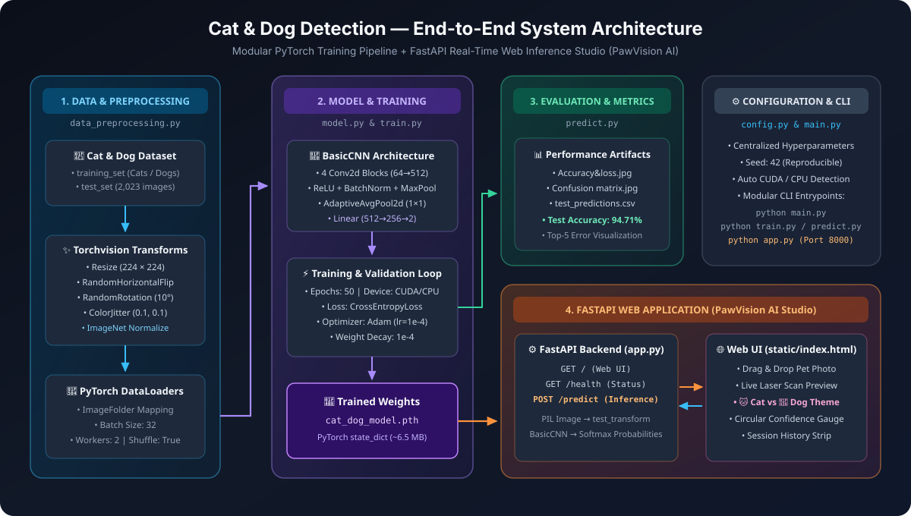
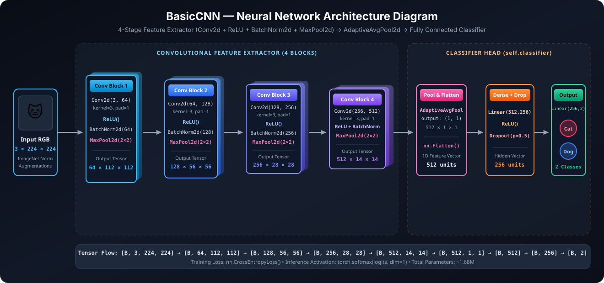

# 🐾 Cat & Dog Detection — PyTorch CNN & FastAPI Web App

An end-to-end Deep Learning image classification project that detects **Cats vs. Dogs** using a custom 4-block Convolutional Neural Network (`BasicCNN`) built with PyTorch, paired with an interactive **FastAPI** web application (**PawVision AI**).

---

## 📁 Project Structure

```text
cat&dog-detection/
├── app.py                   # FastAPI backend server for real-time image prediction
├── static/
│   └── index.html           # PawVision AI interactive frontend web interface
├── assets/
│   ├── project_architecture.svg  # End-to-End System Architecture diagram
│   └── cnn_architecture.svg      # BasicCNN Neural Network Architecture diagram
├── config.py                # Hyperparameters, file paths, and device configuration
├── data_preprocessing.py    # Image transforms, augmentation preview, and DataLoaders
├── model.py                 # BasicCNN architecture and weight loading utilities
├── train.py                 # Training/validation loop, loss/accuracy & confusion matrix plots
├── predict.py               # Single-image inference, test set CSV export & error analysis
├── main.py                  # Full end-to-end training & evaluation pipeline runner
├── cat_dog_detection.py     # All-in-one standalone script version of the pipeline
├── cat-dog-detection.ipynb  # Original Jupyter Notebook
├── requirements.txt         # Python dependencies
└── .gitignore               # Ignored files and dataset folders
```

---

## 🏗️ System & Workflow Architecture



---

## 🧠 Neural Network Architecture (`BasicCNN`)



- **4 Convolutional Blocks**: Each block consists of `Conv2d` (`64 → 128 → 256 → 512` filters, `3×3` kernel, padding `1`) → `ReLU` → `BatchNorm2d` → `MaxPool2d(2)`.
- **Classifier Head**: `AdaptiveAvgPool2d((1, 1))` → `Flatten` → `Linear(512, 256)` → `ReLU` → `Dropout(0.5)` → `Linear(256, 2)`.
- **Input Resolution**: `224 × 224` RGB images normalized with ImageNet mean & standard deviation.

---

## 🚀 Getting Started

### 1. Clone the Repository
```bash
git clone https://github.com/<your-username>/<your-repo-name>.git
cd cat&dog-detection
```

### 2. Create a Virtual Environment & Install Dependencies
```bash
python -m venv venv
# Windows (PowerShell):
.\venv\Scripts\Activate.ps1
# macOS / Linux:
# source venv/bin/activate

pip install -r requirements.txt
```

---

## 🌐 Running the FastAPI Web App

1. Place your trained weights file (`cat_dog_model.pth`) in the project root or inside `outputs/cat_dog_model.pth`.
2. Start the FastAPI server:
   ```bash
   python app.py
   ```
3. Open your browser at:
   - **Web Studio UI**: [http://127.0.0.1:8000](http://127.0.0.1:8000)
   - **Swagger API Docs**: [http://127.0.0.1:8000/docs](http://127.0.0.1:8000/docs)

---

## 🏋️ Training & Evaluation

1. Download the [Kaggle Cat and Dog Dataset](https://www.kaggle.com/datasets/tongpython/cat-and-dog) and extract it under `dataset/cat-and-dog/` (or update `IMAGE_PATH` in `config.py`).
2. Run the training script:
   ```bash
   python train.py
   ```
   This saves:
   - Trained weights: `outputs/cat_dog_model.pth`
   - Training & testing curves: `outputs/Accuracy&loss.jpg`
   - Confusion matrix: `outputs/Confusion matrix.jpg`
3. Run batch evaluation and error analysis on the test set:
   ```bash
   python predict.py
   ```

